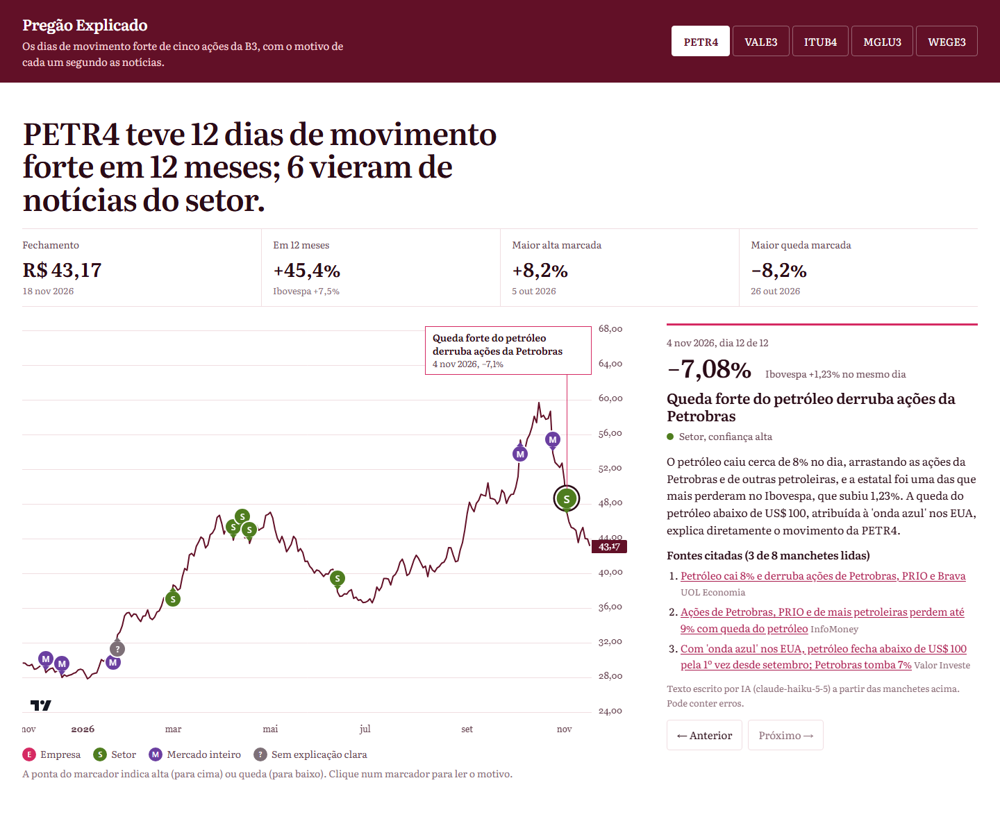
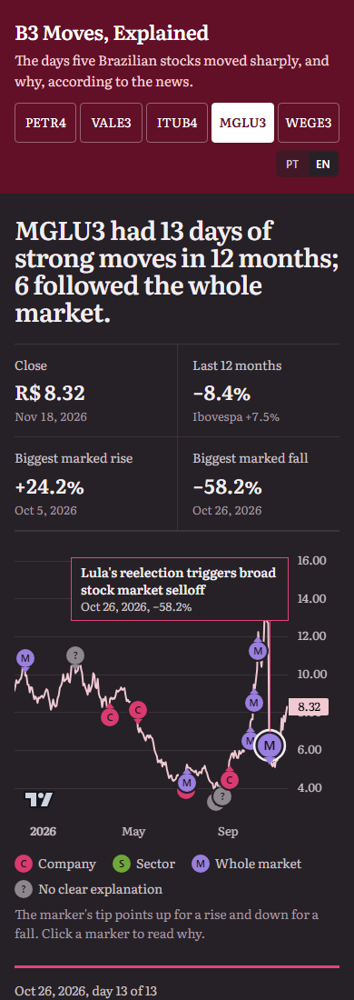
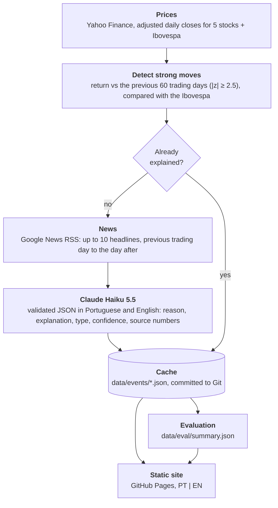

# B3 Moves, Explained

Daily price charts of five B3 stocks where an AI marks the days with unusually strong moves and explains, on the chart itself, what happened, citing the news it used. Every business day after the market closes, a GitHub Actions job detects new moves, writes the explanations and republishes the site.

**Live site: https://beapama.github.io/b3-explained-chart/?lang=en** (switch to Portuguese with the PT | EN button at the top right)

**Built with:** Python, pandas, Claude API (Haiku 5.5, structured output), GitHub Actions, GitHub Pages, plain JavaScript with lightweight-charts.

| Desktop (light, English) | Phone (dark, English) |
|---|---|
|  |  |

Universe: PETR4, VALE3, ITUB4, MGLU3, WEGE3 and the Ibovespa, last 12 months.

## How it works



1. **Prices** (`src/prices.py`): daily adjusted prices via `yfinance`, so dividends do not look like crashes.
2. **Detection** (`src/detect.py`): a day is an event when its return is at least 2.5 standard deviations away from the mean of the previous 60 trading days. Each stock is judged against its own volatility. If the Ibovespa also moved strongly that day in the same direction, the event is tagged as market-wide.
3. **News** (`src/news.py`): Google News RSS from the previous trading day to the day after (weekend news explains Monday moves). Market-wide events reserve half the slots for market news.
4. **Explanation** (`src/explain.py`): Claude Haiku 5.5 reads only those headlines and returns validated JSON (Pydantic), in Portuguese and English in the same call. It cites sources **by their number in the list**, and the code maps numbers to links, so it cannot invent a source. If the headlines do not explain the move, it answers "no clear explanation". Events explained before the English fields existed were translated once by `src/translate.py`, without re-explaining them, so the evaluated Portuguese text did not change.
5. **Cache and pipeline** (`src/pipeline.py`): events are cached by (ticker, date), so the API is never called twice for the same event and a rerun is always safe.
6. **Evaluation** (`src/evaluate.py`): see below.
7. **Site** (`site/`, built by `src/build_site.py`): one HTML, CSS and JS file reading the JSON, with [lightweight-charts](https://github.com/tradingview/lightweight-charts) pinned to 5.0.9. Portuguese and English from one page (a text dictionary per language, `?lang=en` for direct links); light and dark mode follow the system; it works on phones. News headlines stay in Portuguese, since they are the original sources. The build adds a content hash to the CSS and JS links, so browsers never mix a new page with old cached code.
8. **Automation** (`.github/workflows/update.yml`): Monday to Friday at 22:00 UTC (19:00 in Brasília, about an hour after the close). It runs the pipeline, commits `data/` if anything changed and deploys to GitHub Pages.

## Evaluation

| Check | Result |
|---|---|
| Events detected (12 months) | 53 |
| Events with an explanation | 44 (9 "no clear explanation") |
| Cited sources that were in the list given to the model | 133 of 133 (100%) |
| Labeled sample accuracy (15 events, partial = 0.5) | 76.7% (66.7% strict) |
| Accuracy when the model says confidence is high | 92.9% (7 events) |
| Correct event type in the sample | 86.7% |

- **Automatic checks** run on every event at no cost: every cited source must be one of the headlines provided, abstentions must cite nothing, and real answers must cite at least one source.
- **Labeled sample**: 15 events drawn with a fixed seed and stratified by type (4 market, 4 company, 3 sector, 4 no-explanation), so abstentions are judged too. **The labels were produced by a larger model (Claude Opus 5.5) acting as a judge, with a written rationale per row, pending human review.** The site says so as well.
- **Main error pattern**: on stock-specific days with weak headlines, the model sometimes offers a low-confidence guess instead of abstaining. Every abstention in the sample was correct.
- **Retrieval mattered more than the model**: the first backfill left 13 of 53 events unexplained. On market-wide days the company news filled every slot and pushed out the headlines with the actual cause. Two measured retrieval changes brought that to 9, and to 1 of 22 on market-wide days.

## Cost

| Item | Cost |
|---|---|
| One explanation (Claude Haiku 5.5, ~2k input tokens) | ~US$ 0.0004 |
| Full 12-month backfill (53 events) | US$ 0.018 |
| One-time English translation of the 53 cached explanations | US$ 0.0065 |
| Daily run (0–2 new events on a typical day) | < US$ 0.001 |
| **Per month, API** | **< US$ 0.03** |
| GitHub Actions and Pages (public repo) | free |

Each run logs tokens, cost and duration to `data/eval/runs.jsonl`.

## Run it locally

```bash
python -m venv .venv
.venv\Scripts\activate            # Windows; on macOS/Linux: source .venv/bin/activate
pip install -r requirements.txt
cp .env.example .env              # then set ANTHROPIC_API_KEY

python -m src.pipeline --dry-run  # lists new events and the estimated cost, no API calls
python -m src.pipeline            # prices -> detection -> news -> explanations (cached)
python -m src.translate --dry-run # English for events explained before the bilingual schema (one-time)
python -m src.evaluate            # writes data/eval/summary.json
python -m src.build_site          # assembles _site/
python -m http.server 8000 -d _site
```

For the scheduled job, add `ANTHROPIC_API_KEY` as a repository secret and set **Settings → Pages → Source** to **GitHub Actions**.

## Limitations

- The model reads headlines only, not the articles' text.
- Google News RSS and `yfinance` are unofficial sources. Results can change between calls, and either can break or rate-limit.
- 9 of 53 events have no explanation, mostly stock-specific days with few headlines.
- The labeled sample is small (15) and LLM-judged, so its numbers are indicative.
- Market-wide vs stock-specific uses a simple Ibovespa z-score rather than a beta-adjusted abnormal return.

## Next steps

- Make the model abstain whenever its confidence would be low, then re-measure on the same 15 events.
- Add CVM filings (fatos relevantes) as a source for company-specific moves.
- A pytest suite, A/B comparison of prompts, more tickers, Telegram alerts.
- Beta-adjusted abnormal returns; a news API with full article text.

---

Prices: Yahoo Finance. News: Google News. Explanations are AI-generated and may contain errors. This is not investment advice.
